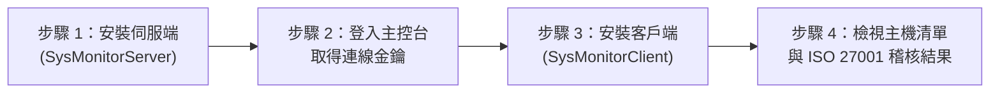

## 第 1 章：文件說明與角色權限總覽

### 1.1 系統用途
本系統自動收集 Windows Server 的軟硬體組態與資安設定。
系統自動比對 12 項 ISO 27001 資安基準，並產出合規稽核報告。

### 1.2 警示標記說明
本指南使用以下三種標記提示重要事項：

> [!IMPORTANT]
> **【重要】**：表示必須執行的關鍵步驟，若略過將導致功能無法運作。

> [!WARNING]
> **【警告】**：表示可能導致連線中斷或權限變更的操作。

> [!CAUTION]
> **【危險】**：表示可能導致資料永久刪除且無法復原的操作。

### 1.3 使用者角色與權限對照表
系統採用角色存取控制 (RBAC)，共分為四種角色：

| 角色名稱 | 角色代碼 | 可執行的功能範圍 |
| :--- | :--- | :--- |
| **系統管理者** | `admin` | 檢視主機、移除主機、設定稽核規則、管理帳號權限、核發臨時密碼、查詢稽核 Log、檢視連線金鑰。 |
| **資安稽核員** | `auditor` | 檢視主機、檢視稽核報告、查詢稽核 Log、匯出 CSV 稽核報表。 |
| **一般檢視者** | `viewer` | 檢視主機清單、檢視主機詳細資訊、檢視稽核結果、變更個人密碼。 |
| **待授權帳號** | `pending` | 新註冊帳號的預設狀態。無法瀏覽任何主機資料，需等待系統管理者開通權限。 |

---

## 第 2 章：快速入門 (Quick Start)

本章節引導您在 10 分鐘內完成伺服端架設、客戶端安裝與首次主機觀測。

### 2.1 步驟一：安裝並啟動伺服端 (Server)
請在中央監控伺服器上執行以下步驟：

1. 解壓縮 `SysMonitorServer_v2.1_Windows_x64.zip`。
2. 將解壓縮後的資料夾複製至 `C:\Tools\SysMonitorServer`。
3. 開啟 `C:\Tools\SysMonitorServer` 資料夾。
4. 在 `一鍵安裝_啟動服務.bat` 檔案上按滑鼠右鍵。
5. 點擊「以系統管理員身分執行」。
6. 如果畫面出現使用者帳戶控制 (UAC) 提示，則點擊「是」。
7. 等待命令提示字元視窗顯示「服務啟動成功」訊息。
8. 按任意鍵關閉視窗。

> [!IMPORTANT]
> 安裝程式會自動註冊 `SysMonitorServer` 系統服務，並自動在 Windows 防火牆開放 8000 通訊埠。

### 2.2 步驟二：首次登入 Web 主控台並複製連線金鑰
1. 點擊桌面上的「SysMonitor 監控主控台」捷徑（或開啟瀏覽器輸入 `http://localhost:8000`）。
2. 如果系統尚未建立任何帳號，則畫面會顯示「首次啟動系統初始化設定」。
3. 輸入您要建立的「管理員帳號」與「管理員密碼」。
4. 點擊「建立管理員並登入」按鈕。
5. 登入成功後，點擊左側選單「系統資安管理」下方的「Client 連線金鑰」。
6. 點擊右側畫面的「📋 複製」按鈕，將 `api_token` 複製到剪貼簿。

### 2.3 步驟三：安裝並設定客戶端 (Client)
請在受監控的 Windows Server 上執行以下步驟：

1. 解壓縮 `SysMonitorClient_v2.1_Windows_x64.zip`。
2. 將解壓縮後的資料夾複製至 `C:\Tools\SysMonitorClient`。
3. 開啟 `C:\Tools\SysMonitorClient` 資料夾。
4. 在 `一鍵安裝_啟動服務.bat` 檔案上按滑鼠右鍵。
5. 點擊「以系統管理員身分執行」。
6. 安裝完成後，系統會自動開啟「SysMonitor 客戶端參數設定工具」視窗。
7. 在「伺服器接收網址 (server_url)」欄位輸入中央伺服器的網址（例如：`http://172.29.0.100:8000/api/v1/reports`）。
8. 在「安全認證金鑰 (api_token)」欄位貼上您在步驟 2.2 複製的金鑰。
9. 點擊「儲存設定」按鈕。
10. 點擊「立即測試回報一次」按鈕。
11. 確認狀態列顯示「回報成功 (HTTP 200)」。

### 2.4 步驟四：在 Web 主控台確認主機與稽核狀態
1. 回到中央伺服器的 Web 主控台瀏覽器畫面。
2. 點擊左側選單的「查看主機清單」。
3. 點擊右上角的「🔄 重新整理清單」按鈕。
4. 確認主機清單中已出現剛才安裝的伺服器紀錄。
5. 點擊該主機「稽核結果」欄位的狀態標籤，即可檢視 12 項 ISO 27001 自動稽核明細。

---

## 第 3 章：帳號登入、註冊與導覽介面操作

### 3.1 登入系統
1. 開啟瀏覽器（建議使用 Microsoft Edge 或 Google Chrome）。
2. 輸入系統網址並按 `Enter` 鍵。
3. 在「登入系統」頁籤中，輸入您的「使用者帳號」與「密碼」。
4. 點擊「登入主控台」按鈕。

### 3.2 申請註冊新帳號
如果您沒有帳號，請依下列步驟申請：

1. 在登入畫面點擊「申請註冊」頁籤。
2. 輸入「使用者帳號」（限英文字母、數字、底線或連字號，長度 3 至 32 字元）。
3. 輸入「設定密碼」（長度至少 6 字元）。
4. 在「確認密碼」欄位再次輸入相同密碼。
5. 點擊「註冊並立即登入」按鈕。

> [!IMPORTANT]
> 新註冊帳號預設為「待授權 (pending)」狀態。請通知系統管理員將您的角色調整為「一般檢視者 (viewer)」或更高權限，方能查看主機資料。

### 3.3 操作左側功能導覽選單
主控台畫面分為「左側功能導覽選單」與「右側功能頁面」兩大區塊：

- **切換功能頁面**：點擊左側選單中的任一功能按鈕，右側區塊會立即切換至對應頁面。
- **收合或展開選單**：點擊左側選單右上角的「◀」按鈕，可將選單收合為窄版圖示列。將滑鼠游標移至圖示上方，會顯示功能名稱提示。
- **自由調整選單寬度**：將滑鼠游標移至左側選單與右側內容之間的分隔線上，按住滑鼠左鍵左右拖曳即可調整寬度。在分隔線上連按兩下滑鼠左鍵，可還原預設寬度。
- **登出系統**：點擊左側選單最下方的「登出」按鈕，即可安全結束連線並返回登入畫面。

### 3.4 切換淺色與深色佈景主題
1. 查看畫面最上方工具列的右側區域。
2. 點擊「🌙 深色」或「☀️ 淺色」按鈕。
3. 系統會立即切換配色，並自動記住您的偏好設定。

---

## 第 4 章：主機清單與詳細資訊檢視

### 4.1 查詢與篩選主機清單
1. 點擊左側選單「主機觀測與稽核」下方的「查看主機清單」。
2. 若要篩選特定主機，請在上方搜尋列輸入條件：
   - **依主機名稱篩選**：輸入電腦名稱關鍵字。
   - **依 IP 篩選**：輸入 IP 位址關鍵字（清單預設優先顯示 `172.29` 開頭之企業內部 IP）。
   - **磁碟 % >=**：輸入數字（0 至 100），篩選任一磁碟分割區使用率達到該百分比的主機。
   - **稽核狀態下拉選單**：選擇「全部稽核狀態」、「✅ 通過 (合規)」或「❌ 未合規」。
3. 點擊「查詢」按鈕套用篩選。
4. 若要顯示全部主機，請點擊「清除」按鈕。

### 4.2 檢視主機詳細資訊對話視窗
1. 在主機清單中，找到目標主機。
2. 點擊該列最右側「操作」欄位的「查看」按鈕。
3. 畫面會彈出「🖥️ 主機詳細資訊」對話視窗。
4. 點擊視窗上方的頁籤，切換檢視不同類別的組態資料：
   - **總覽**：顯示電腦名稱、IP、網域狀態、RDP 狀態、CPU、記憶體與磁碟使用率圖表。
   - **🛡️ 稽核報告**：顯示該主機的 ISO 27001 合規判定結果。
   - **IP 資訊**：列出所有網路卡介面、MAC 位址與 IPv4 / IPv6 位址。
   - **密碼原則**：顯示密碼複雜度、最短長度、使用期限與帳戶鎖定閾值。
   - **Windows 更新**：顯示最近安裝的 HotFix / KB 更新紀錄（已轉換為台北時間 UTC+8）。
   - **Windows Log**：顯示事件日誌大小上限、保留天數、最舊一筆時間與最新一筆時間。
   - **防火牆與防毒**：顯示網域、私人、公用防火牆狀態，以及防毒軟體安裝與啟動狀態。
   - **帳號**：列出本機所有使用者帳號、啟用狀態与密碼到期設定。
   - **群組**：列出本機群組與成員清單。
   - **AD 帳號**：列出網域帳號相關紀錄。
   - **帳號變更**：列出 Windows 安全事件 ID 4720（新增帳號）等異動紀錄。
   - **回報歷史**：列出該主機過去所有的回報時間紀錄。
5. 若要放大視窗，請點擊對話視窗右上角的「⛶ 全螢幕」按鈕。
6. 檢視完畢後，點擊右上角的「×」按鈕或按鍵盤 `Esc` 鍵關閉視窗。

### 4.3 檢視歷史回報快照
1. 開啟目標主機的「🖥️ 主機詳細資訊」對話視窗。
2. 點擊最右側的「回報歷史」頁籤。
3. 在歷史清單中找到您想檢視的時間點。
4. 點擊該筆紀錄右側的「調閱當時快照」按鈕。
5. 視窗上方會出現「⚠️ 目前顯示歷史快照」提示，所有頁籤內容將切換為該時間點的歷史數據。

### 4.4 移除主機紀錄（限系統管理者）
> [!CAUTION]
> 移除主機將同時刪除該主機的所有歷史回報快照，刪除後無法復原。

1. 以 `admin` 角色登入系統，進入「查看主機清單」。
2. 找到要移除的主機紀錄。
3. 點擊該列最右側的「🗑️ 移除」按鈕。
4. 在彈出的確認對話框中，核對主機名稱與 IP 位址。
5. 點擊「確定」，系統將立即移除該主機並寫入資安稽核日誌。

---

## 第 5 章：ISO 27001 合規稽核檢視與規則設定

### 5.1 檢視單一主機合規稽核報告
1. 在「查看主機清單」頁面中，查看「稽核結果」欄位。
   - **✅ 合規 (12/12)**：代表該主機通過全部 12 項資安基準。
   - **❌ 不合規 (X/12)**：代表有未通過的項目。
2. 點擊該主機的「稽核結果」按鈕。
3. 系統會彈出「🛡️ ISO 27001 主機安全性稽核報告」對話視窗。
4. 在表格中檢視每一項稽核的「判定結果」、「稽核標準要求」與「目前主機設定值」。
5. 未通過的項目會以紅底標示，協助管理員快速定位不符合規定的組態。

### 5.2 自訂 ISO 27001 稽核規則（限系統管理者）
1. 點擊左側選單「主機觀測與稽核」下方的「稽核規則設定」。
2. 在頁面中調整各項稽核門檻數值或下拉選項。
3. 調整完畢後，點擊右上角或最下方的「💾 儲存稽核規則」按鈕。
4. 系統會立即儲存規則，並自動重新計算所有主機的合規狀態。

### 5.3 還原預設稽核規則（限系統管理者）
1. 進入「稽核規則設定」頁面。
2. 點擊右上角的「↺ 重設為系統預設值」按鈕。
3. 在確認提示視窗中點擊「確定」，所有門檻將立即恢復為系統預設標準。

### 5.4 12 項預設稽核基準速查表

| 項次 | 稽核項目 | 系統預設合規標準 |
| :---: | :--- | :--- |
| 1 | **CPU 核心數需求** | CPU 邏輯核心數必須大於 4 核心（即至少 5 核心以上，或 >= 4 依門檻設定）。 |
| 2 | **記憶體容量需求** | 實體記憶體總量 >= 16 GB（包含 0.6 GB 容許誤差，即實際偵測 >= 15.4 GB 為合規）。 |
| 3 | **磁碟配置與容量** | 至少具備 2 個磁碟槽（系統磁碟與資料磁碟），且每個磁碟總容量皆 >= 100 GB。 |
| 4 | **作業系統版本需求** | 必須比 Windows Server 2016 或 Windows 11 新（例如 Server 2019 / 2022 / 2025）。 |
| 5 | **密碼安全性原則** | 必須同時滿足：(1) 啟用密碼複雜度、(2) 密碼長度下限 >= 12 字元、(3) 最長使用期限 <= 90 天、(4) 強制密碼歷程記錄 > 1 次。 |
| 6 | **Administrator 帳號狀態** | 本機內建之 `Administrator` 帳號必須停用。 |
| 7 | **未加入 AD 網域之管理員** | 如果主機未加入 AD 網域，則本機 Administrators 群組至少要有 1 個啟用的本機管理員帳號。 |
| 8 | **已加入 AD 網域之管理員** | 如果主機已加入 AD 網域，則本機 Administrators 群組至少要包含 1 個 AD 網域帳號。 |
| 9 | **NTP 時間同步伺服器** | 必須包含以下任一組伺服器：`172.29.0.26`、`172.29.0.22` 或 `idtwkdc01-2016.idtech.com.tw`。 |
| 10 | **Windows Update 更新時效** | 最近一次安裝更新的時間，距離今日必須小於半年（180 天）。 |
| 11 | **Windows Log 保存時效** | 事件日誌（Application / Security / System）最舊一筆紀錄距今必須大於 1 個月（30 天）。 |
| 12 | **防火牆與防毒軟體** | 網域、私人、公用網路防火牆皆必須啟用；且必須安裝並啟用防毒軟體。 |

---

## 第 6 章：個人帳號管理

### 6.1 查看個人帳號角色與權限
1. 點擊左側選單「個人帳號管理」下方的「帳號資訊與角色」。
2. 畫面上方會顯示您的「使用者名稱」、「帳號身分角色」與「帳號狀態」。
3. 畫面下方列出三種角色的詳細權限說明，並以藍框標示您目前所屬的角色。

### 6.2 變更個人登入密碼
1. 點擊左側選單「個人帳號管理」下方的「變更個人密碼」。
2. 在「目前密碼 (原密碼)」欄位輸入您現在使用的密碼。
3. 在「新密碼」欄位輸入新的密碼（長度至少 6 字元；建議 8 字元以上並含英文大小寫、數字與符號）。
4. 在「確認新密碼」欄位再次輸入相同的新密碼。
5. 點擊「確認變更密碼」按鈕。
6. 畫面顯示綠色「✅ 密碼已成功變更！」訊息，即完成更新。

---

## 第 7 章：帳號與權限管理 - RBAC（限系統管理者）

### 7.1 新增系統使用者帳號
1. 點擊左側選單「系統資安管理」下方的「帳號權限管理 (RBAC)」。
2. 點擊右上角的「➕ 新增使用者帳號」按鈕。
3. 在展開的表單中輸入「使用者帳號」與「登入密碼」。
4. 在「角色權限」下拉選單中選擇要指派的角色（待授權、一般檢視者、資安稽核員或系統管理者）。
5. 點擊「確認建立」按鈕。

### 7.2 變更使用者角色與啟用狀態
1. 在「帳號權限管理 (RBAC)」的使用者列表中，找到目標帳號。
2. **變更角色**：點擊該帳號「角色權限」欄位的下拉選單，選擇新角色，系統將自動儲存並生效。
3. **停用或啟用帳號**：點擊該列右側的「停用」或「啟用」按鈕，即可切換該帳號的登入權限。

### 7.3 協助忘記密碼之使用者產生「臨時密碼」
當使用者忘記密碼時，系統管理者可為其核發一組 **30 分鐘內有效** 的一次性臨時登入密碼：

1. 進入「帳號權限管理 (RBAC)」頁面。
2. 在使用者列表中找到忘記密碼的帳號。
3. 點擊該列右側的「🔑 臨時密碼」按鈕。
4. 在彈出的確認視窗中點擊「確定」。
5. 畫面會彈出「🔑 臨時登入密碼已核發」對話視窗，並自動全選 10 碼臨時密碼。
6. 點擊「📋 複製」按鈕，按鈕會顯示「✅ 已複製！」。
7. 點擊「確認完成」關閉視窗，並透過安全的內部通訊管道將該臨時密碼交付給使用者。

### 7.4 使用者以臨時密碼登入並重設密碼
1. 使用者在登入畫面輸入自己的帳號，並在密碼欄貼上管理員提供的「臨時密碼」。
2. 點擊「登入主控台」。
3. 登入成功後，點擊左側選單「個人帳號管理」下方的「變更個人密碼」。
4. 在「目前密碼 (原密碼)」欄位輸入剛才使用的「臨時密碼」。
5. 輸入「新密碼」與「確認新密碼」，點擊「確認變更密碼」。
6. 變更完成後，舊的臨時密碼將自動作廢。

> [!WARNING]
> 臨時密碼自核發起算 30 分鐘後自動失效。若超過時間未登入，請聯繫系統管理者重新核發。

### 7.5 刪除使用者帳號
1. 在「帳號權限管理 (RBAC)」列表中找到目標帳號。
2. 點擊該列最右側的「🗑️ 刪除」按鈕。
3. 在確認對話框中點擊「確定」。

> [!NOTE]
> 為確保系統安全，您無法刪除自己目前正在登入的帳號，且系統強制保留至少一位啟用中的系統管理者。

---

## 第 8 章：ISO 27001 資安稽核日誌與舉證匯出（限管理者與稽核員）

### 8.1 查詢與篩選資安稽核日誌
系統自動記錄所有登入、登出、檢視主機、修改規則、變更權限與核發臨時密碼之行為：

1. 點擊左側選單「系統資安管理」下方的「稽核 Log (Audit)」。
2. 在上方篩選列設定查詢條件：
   - **帳號**：輸入操作者帳號名稱。
   - **全部事件類型**：下拉選擇特定事件（例如 `AUTH_LOGIN`、`HOST_VIEW_DETAIL`、`AUDIT_RULES_UPDATE` 等）。
   - **全部狀態**：選擇 `SUCCESS (成功)` 或 `FAILED (失敗)`。
   - **關鍵字搜尋**：輸入說明文字、IP 位址或主機名稱。
   - **起始日期 / 結束日期**：選擇要調閱的日期區間。
3. 點擊「🔍 查詢」按鈕。
4. 若要清除篩選條件，請點擊「↺ 重設」按鈕。

### 8.2 匯出 CSV 稽核報表
1. 在「稽核 Log (Audit)」頁面設定好要匯出的篩選條件與日期區間。
2. 點擊右上角的「📥 匯出 CSV 報表」按鈕。
3. 瀏覽器會自動下載 UTF-8 BOM 編碼的 `.csv` 檔案，可直接以 Microsoft Excel 開啟作為 ISO 27001 稽核舉證資料。

---

## 第 9 章：Client 連線金鑰與客戶端工具操作

### 9.1 檢視與修改伺服端連線金鑰（限系統管理者）
1. 點擊左側選單「系統資安管理」下方的「Client 連線金鑰」。
2. 點擊「📋 複製」按鈕即可複製目前的金鑰。
3. 如果需要更換金鑰，請至中央伺服器的安裝目錄下，以記事本開啟 `.env` 檔案。
4. 修改 `API_TOKEN=您的新金鑰` 並儲存檔案。
5. 執行伺服端目錄下的 `一鍵重啟服務.bat` 使新金鑰生效。

### 9.2 使用客戶端參數設定工具 (`SysMonitorConfig.exe`)
在被監控的 Windows Server 上，您可以隨時透過圖形介面調整回報設定：

1. 點擊桌面上的「SysMonitor 監控設定」捷徑（或執行客戶端目錄下的 `啟動參數設定工具.bat`）。
2. 在視窗中可調整以下參數：
   - **伺服器接收網址 (server_url)**：中央伺服器的 API 網址。
   - **安全認證金鑰 (api_token)**：必須與伺服端的 Client 連線金鑰完全一致。
   - **主機唯一識別碼 (host_uuid)**：預設自動帶入本機電腦名稱。
   - **回報間隔秒數 (report_interval_seconds)**：預設為 `300` 秒（每 5 分鐘自動回報一次）。
3. 修改後點擊「儲存設定」。
4. 點擊「重啟背景服務」按鈕，讓背景服務套用新設定。

---

## 第 10 章：常見問題與故障排除 (Troubleshooting)

### 問題 1：客戶端點擊「立即測試回報一次」顯示連線失敗或 401 錯誤
- **原因 A**：客戶端的 `api_token` 與伺服端不一致。
  - **解決步驟**：登入伺服端 Web 主控台，前往「Client 連線金鑰」複製金鑰，貼回客戶端設定工具並儲存。
- **原因 B**：中央伺服器的防火牆阻擋了 8000 通訊埠。
  - **解決步驟**：在中央伺服器上以系統管理員身分重新執行一次 `一鍵安裝_啟動服務.bat`，腳本將自動建立防火牆允許規則。

### 問題 2：登入後畫面顯示「您的帳號目前處於待授權 (Pending) 狀態」
- **原因**：新註冊的帳號預設無檢視權限。
- **解決步驟**：請聯繫系統管理者登入 Web 主控台，進入「帳號權限管理 (RBAC)」，將您的帳號角色由「待授權 (pending)」改為「一般檢視者 (viewer)」後，點擊畫面上的「🔄 重新整理檢查授權狀態」按鈕。

### 問題 3：主機的「記憶體容量」實際為 15.8 GB，為何稽核結果仍顯示「合規」？
- **原因**：Windows 作業系統會保留部分硬體記憶體供核心與韌體使用，導致系統回報的可用實體記憶體略低於 16.0 GB。
- **系統設計**：系統內建 **0.6 GB 容許誤差範圍**，只要主機記憶體達 `15.4 GB` 以上，即判定符合 16 GB 規格要求。

### 問題 4：如何手動檢查或重啟 Windows 背景服務？
1. 在鍵盤按下 `Win + R` 組合鍵，開啟「執行」視窗。
2. 輸入 `services.msc` 並按 `Enter` 鍵。
3. 在服務清單中尋找：
   - 伺服端服務名稱：`SysMonitorServer (ISO 27001 系統安全觀測中心伺服端服務)`
   - 客戶端服務名稱：`SysMonitorClient (ISO 27001 系統安全觀測客戶端服務)`
4. 在服務名稱上按右鍵，即可選擇「啟動」、「停止」或「重新啟動」。
